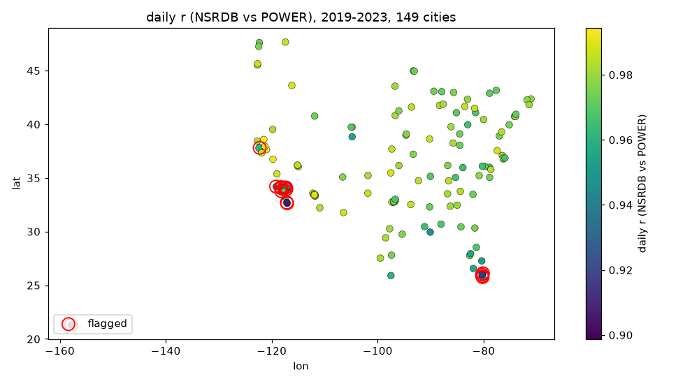
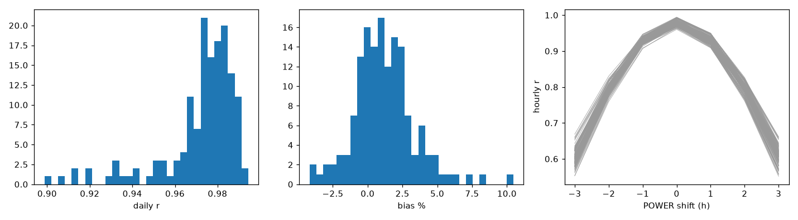
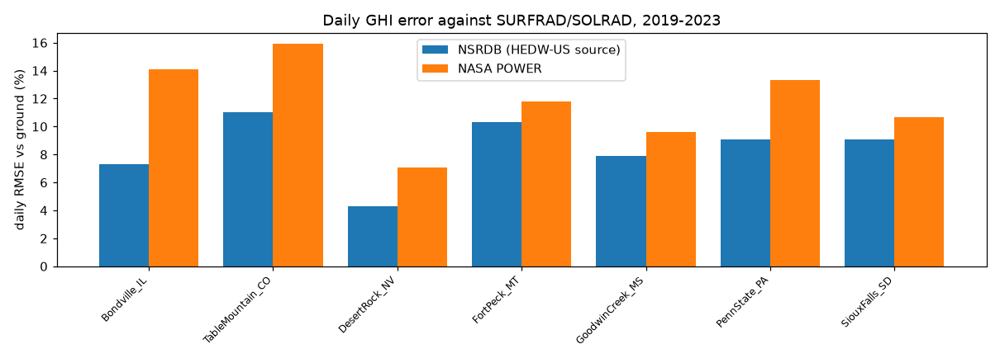
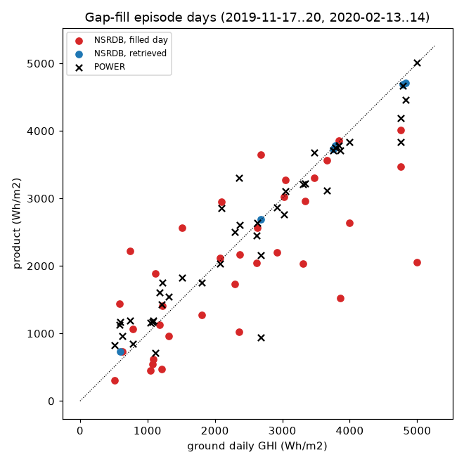

# Agent: solar-irradiance coherence, HEDW-US (NSRDB) vs NASA POWER, 2019–2023

## Question

Is the HEDW-US solar irradiance coherent with NASA POWER (ASDC) over the paper's period (2019-01-01 to 2023-12-31 UTC)? Where it is not, what is anomalous, and is the anomaly in HEDW-US's data or in the comparison?

HEDW-US's `solar_GHI` is the NSRDB GOES aggregated v4.0.0 GHI requested by the authors' code; see [source-upstream-code.md](source-upstream-code.md). `data.zip` is still not available ([concept-data-access.md](concept-data-access.md)). The agent therefore re-downloads that NSRDB stream with the authors' exact request and compares it with POWER `ALLSKY_SFC_SW_DWN`. Values and timing equal HEDW-US's up to its row labels, as the [concept-nsrdb.md](concept-nsrdb.md) half-hour note explains. Processing that HEDW-US did after the download (the 40 quarantined cities, smoothing) is not checked here.

## Design

| Step | What | Code |
|---|---|---|
| Data | 150 target cities: 745 NSRDB city-years (Anchorage has no GOES coverage) and 150 POWER 5-year hourly series | `agent/fetch/fetch_all.py` |
| Detector | Per city: correlation, lag scan, bias, RMSE, physics checks, monthly bias, anomalous days (robust z of the daily log ratio) | `agent/coherence.py` |
| Aggregation | Robust z across cities, flags, `cities.csv`, `city_years.csv`, `anomalous_days.csv`, `summary.json`, figures | `agent/aggregate.py` |
| Gap-fill audit | NSRDB `fill_flag` / `cloud_type` for 745 city-years vs the anomalies | `agent/fillflags.py` |
| Aurora | `qsub` to `debug`, project `IOWarp`: 1 node, `mpiexec` N ranks over the city manifest, then aggregation | `agent/pbs/{submit.sh,coherence.pbs,worker.sh}` |
| Login node | The same worker run as P local processes | `agent/run_local.sh` |
| clio-agent | Plugin agent `hedw/solar-coherence` (clio-agent 0.9.7.1, Mistral Large 4 on ALCF Minerva) with tools `hedw_report` (run digest or one city) and `hedw_day` (hourly NSRDB vs POWER for one city-day) | `agent/clio-agent/` |
| clio-coder | Headless `clio-coder run` (target `alcf-metis`, `gpt-oss-120b`) writes `interpretation.md`; `check_numbers.py` checks every number in it against the run files | `agent/interpret.sh`, `agent/check_numbers.py` |

Metric definitions and thresholds are in [concept-solar-coherence.md](concept-solar-coherence.md).

## Runs

| Run | Where | Job | Detect | Aggregate |
|---|---|---|---|---|
| `agent/results/run_20261120T143434Z_local_p16/` (reference) | Login node `aurora-uan-0012`, 16 processes | none | 2.59 s | 1.34 s |
| `agent/results/run_20261120T143515Z_n1p50/` | Compute node `x4315c1s0b0n0`, 50 ranks | PBS 9107657 | 7.18 s | 2.90 s |
| `agent/results/run_20261120T143947Z_n1p16/` | Compute node, 16 ranks | PBS 9107666 | 7.43 s | 2.95 s |

The three runs give the same `summary.json`, except the timing fields, and a byte-identical `cities.csv`. Workflow timings are in [workflow_aurora_clio.md](workflow_aurora_clio.md).

## Results

### Timing and agreement (149 cities)

- **Phase:** the best lag is **0 h in all 745 city-years**. NSRDB's H:30 value lines up with POWER's H:00–H+1:00 mean, as predicted. HEDW-US row labels are therefore 30 min early but internally consistent (see [concept-nsrdb.md](concept-nsrdb.md)). There is no time-zone or DST error in the solar stream.
- **Correlation:**

  | Correlation | Median | p05 | Min |
  |---|---|---|---|
  | Hourly r | 0.9785 | 0.967 | 0.9604 |
  | Daily r | 0.9768 | 0.9321 | 0.8987 (Chula Vista) |

- **Error:**
  - **Bias** (ΣNSRDB/ΣPOWER − 1): median +1.11 %, p05 −2.09 %, p95 +4.76 %, range −4.17 % to +10.47 %.
  - **Daylight RMSE:** median 79.5 W/m².
  - Bias correlates with latitude at −0.216.
- **Physics:**
  - No night-time GHI, no negative GHI, and no missing hours in either source.
  - 26 cities have short flat runs of 3 to 6 daylight hours, too few to matter.
- **Per-city-year thresholds:** none of the city-years trips one, so the dataset passes the [concept-solar-coherence.md](concept-solar-coherence.md) thresholds everywhere.

### Anomalous cities: 17, all coastal or at a mountain edge

The cross-city robust z (|z| > 3) flags 17 cities. Every one of them sits where a 1° (~100 km) POWER cell mixes ocean and land, or mountains and basin:

| Group | Cities | Daily r | Bias |
|---|---|---|---|
| Coastal Southern California | Chula Vista, San Diego, Long Beach, Los Angeles, Oxnard, Glendale | 0.8987–0.9505 | −3.09 to +10.47 % |
| Inland Empire | Ontario, Fontana, San Bernardino, Rancho Cucamonga, Moreno Valley | 0.9184–0.9508 | −4.17 to +5.10 % |
| Bay Area | Oakland (bias only, z = +3.3) | 0.9549 | +7.25 % |
| South Florida | Fort Lauderdale, Pembroke Pines, Hialeah, Miami | 0.9133–0.9420 | +2.19 to +5.76 % |
| Hawaii | Honolulu | 0.935 | +4.05 % |

Pembroke Pines and Rancho Cucamonga are among the 7 targets that cannot be in the release.

Mean monthly bias by calendar month (`seasonal_bias.txt` in the run):

| Group | Jan | Feb | Mar | Apr | May | Jun | Jul | Aug | Sep | Oct | Nov | Dec | Mean daily r |
|---|---|---|---|---|---|---|---|---|---|---|---|---|---|
| SoCal coast (6) | 1.2 | 0.8 | 0.2 | 1.4 | −1.1 | 3.5 | **9.1** | **6.7** | 2.7 | 3.0 | 4.4 | 1.8 | 0.923 |
| Inland Empire (5) | −1.1 | **−5.1** | **−7.0** | **−6.6** | **−6.6** | −0.1 | 3.3 | 3.0 | −1.1 | −0.7 | 0.9 | −1.6 | 0.933 |
| South Florida (4) | 2.6 | 3.6 | 2.4 | 4.5 | 4.3 | 3.6 | 6.4 | 5.5 | 3.1 | 1.9 | −0.4 | 1.8 | 0.928 |
| Honolulu | 4.3 | 3.0 | 3.7 | 5.5 | 1.7 | 2.6 | 5.2 | 4.6 | 3.7 | 5.7 | 5.7 | 3.4 | 0.935 |
| All other 133 | −1.6 | 0.1 | −0.7 | 0.5 | 1.6 | 2.2 | 2.7 | 2.3 | 2.5 | 0.6 | −0.6 | −1.8 | 0.977 |

**Interpretation (hypotheses, not verified against ground stations):**
- **Coastal Southern California:** NSRDB reads high against POWER in summer. That fits a POWER cell that takes in the persistent offshore marine stratus, while NSRDB's ~4 km pixel sees the city after the morning burn-off.
- **Inland Empire:** NSRDB reads low in late winter and spring. Here the POWER cell spans the San Gabriel and San Bernardino mountains and the high desert.
- **South Florida and Honolulu:** POWER cells that are partly ocean.

These are representativeness differences between a 4 km and a 100 km product. They are not errors in HEDW-US.

### Anomalous days and a real NSRDB artefact: 2020-02-14

- **Volume:** each city's own robust outlier test flags a median of 38 days per city, up to 227 (San Bernardino and Ontario), 7,528 city-days in all. Most are cloud-scale disagreements.
- **Spread across cities:** counting cities where NSRDB is under half of POWER's daily total (with POWER above 2,000 Wh/m²) per date (`widespread_dates.json`):
  - **2020-02-14 stands out, with 31 cities.** They span 17 eastern states, from Alabama and Georgia to Minnesota and Massachusetts.
  - The next date, 2020-03-13, has 12 cities.
- **Birmingham hour by hour:**
  - On 2020-02-14, POWER all-sky equals POWER clear-sky in 9 of 10 daylight hours: a clear day.
  - NSRDB has DNI = 0 and a flat GHI of 25–51 W/m² from sunrise to sunset.
  - On 2020-02-15, NSRDB follows clear-sky closely: 764 W/m² at 17 UTC against POWER clear-sky 775.
- **Cause:** NSRDB's own flags (`raw/nsrdb/flags/Alabama_Birmingham_2020_flags.csv`) give every daylight hour that day **Fill Flag 100** and Cloud Type 4 (super-cooled water). The irradiance was gap-filled rather than retrieved.
- **Effect on HEDW-US:** the regional filled day passes into HEDW-US's `solar_GHI` unflagged. The dataset keeps no fill flag, so pristine cities with "zero missing values" can still carry imputed solar values. The agent flags these days for removal or masking in solar-driven load models.
- **NSRDB reads high:** this mostly happens in snow events, for example 2021-02-17 (Winter Storm Uri) in 15 cities and 2021-02-10 in 11. This fits the known difficulty of telling snow from cloud in satellite retrievals. For Dallas on 2021-02-17, NSRDB has 2,623 Wh/m² against POWER's 719.

### Gap filling across all cities (`fillflags.json`, `fill_episodes.txt`)

A second NSRDB pass downloaded `ghi, clearsky_ghi, cloud_type, fill_flag` for all 745 city-years (1,010 s). `agent/fillflags.py` counts daylight hours (clear-sky GHI > 200 W/m², which excludes the low-sun hours) whose fill flag is ≥ 50.

- **Routine filling:** a median of **1.34 %** of daylight hours per city are mostly gap-filled. The range is 0.65 % to 8.04 %, the highest in North Las Vegas.
- **Two domain-wide episodes:**
  - The episodes are **2019-11-17 to 2019-11-20** and **2020-02-13 to 2020-02-14**.
  - On each of these six days, at least half the daylight hours are filled in **the same 109 cities**: every target city east of about −113° longitude, from −112.2 to −71.1.
  - None of the 40 cities at −115° or further west is affected.
  - The whole eastern satellite side of NSRDB was therefore filled: no retrieval, apparently missing GOES-East input (cause not verified).
  - The 31 cities with NSRDB under half of POWER on 2020-02-14 are the clear-sky part of this episode. On cloudy days the filled values happen to land closer to POWER.
- **Anomalous days are enriched:** 4.28 % of the listed anomalous days (150 of 3,508) are filled days, against a base rate of 0.615 % of all days. That is about 7× chance.
- **Flagged cities fill more:** their median filled share of daylight hours is 3.73 %, against 1.31 % for the other cities, so part of their low correlation comes from NSRDB's own gaps.

**Consequence for HEDW-US:** the six filled days, about 1.3 % of daylight hours, and longer gaps in the West pass into `solar_GHI` with no flag, because the HEDW-US columns do not include `Fill Flag`. Solar features such as `btm_solar_proxy` and `solar_volatility_3h` inherit them. Users training solar-driven load models should mask these days. The list is in `fillflag_days.csv`, and the agent's `hedw_day` tool now shows the fill flag per hour.

## Ground truth: SURFRAD and SOLRAD

**Can the flagged cities be checked against ground stations?** Not directly. The nearest station to any flagged city is 238 km away:
- Southern California: Hanford or Desert Rock, 238–454 km.
- South Florida: Goodwin Creek, about 1,300 km.
- Honolulu: about 4,000 km.

None is in a comparable coastal climate ([source-noaa-surfrad-solrad.md](source-noaa-surfrad-solrad.md)).

**What the stations can test:**
1. Which product is closer to the ground at the station sites: NSRDB, the HEDW-US source, or POWER.
2. Whether NSRDB's gap-filled values are wrong.

Both products were fetched for the exact station coordinates. The ground value is the hourly mean of 1-min QC-0 data, using the component sum where available. Daylight means zenith < 85° with all three series valid.

**Run:** `agent/results/ground_20261120_surfrad/`, with the **7 SURFRAD stations**, 2019–2023. The 7 SOLRAD stations are waiting on GML throttling and will be added to this table when they arrive.

| Station | Daily r NSRDB | Daily r POWER | Daily MBE % NSRDB | Daily MBE % POWER | Daily RMSE % NSRDB | Daily RMSE % POWER | Hourly RMSE W/m² NSRDB | Hourly RMSE W/m² POWER | Days NSRDB closer |
|---|---|---|---|---|---|---|---|---|---|
| Bondville_IL | 0.9926 | 0.9709 | 1.37 | -2.13 | 7.3 | 14.1 | 53.0 | 88.6 | 0.73 |
| TableMountain_CO | 0.9738 | 0.9337 | 1.02 | -0.2 | 11.0 | 15.9 | 91.6 | 117.5 | 0.627 |
| DesertRock_NV | 0.9938 | 0.9843 | -0.01 | -1.74 | 4.3 | 7.1 | 52.3 | 72.9 | 0.736 |
| FortPeck_MT | 0.9864 | 0.9801 | -1.01 | -0.75 | 10.3 | 11.8 | 65.1 | 77.2 | 0.567 |
| GoodwinCreek_MS | 0.9905 | 0.9821 | 3.16 | 0.98 | 7.9 | 9.6 | 62.1 | 78.7 | 0.595 |
| PennState_PA | 0.9893 | 0.9764 | 1.57 | 1.29 | 9.1 | 13.3 | 62.5 | 87.7 | 0.632 |
| SiouxFalls_SD | 0.9873 | 0.9811 | 1.23 | 1.02 | 9.1 | 10.7 | 59.5 | 72.2 | 0.568 |

**Findings:**

1. **NSRDB is closer to the ground than POWER at all 7 stations.**
   - Median daily RMSE is 9.1 % for NSRDB against 11.8 % for POWER.
   - Median hourly RMSE is 62.1 against 78.7 W/m².
   - Median daily r is 0.9893 against 0.9801.
   - NSRDB is closer on a median 63 % of days.
   - The largest POWER penalty is at Table Mountain, on the Front Range edge (15.9 % against 11.0 %), and at Bondville (14.1 % against 7.3 %).

   In this comparison POWER is the noisier reference. That supports reading the 17 flagged cities as POWER representativeness (1° cells), not an HEDW-US defect, though it is not proof for those cities.

2. **Routine NSRDB gap filling is harmless.**
   - Filled hours outside the episodes (9064 station-hours): NSRDB RMSE 36.6 W/m² against POWER 41.2 on the same hours, with a median NSRDB MBE of -4.0 %.
   - Retrieved hours: NSRDB 63.0 against POWER 80.4.

3. **The domain-wide fill episodes are genuinely wrong in NSRDB, and so in HEDW-US.**
   - On the six episode days, 36 station-days were filled (all SURFRAD stations from -105.237 to -77.93 longitude). Desert Rock at −116.0° was not filled, consistent with the −113° split.
   - Median absolute daily error is **28.2 % for NSRDB against 10.2 % for POWER**.
   - Hourly RMSE on the episode hours (322 station-hours) is 107.5 W/m² for NSRDB against 63.1 for POWER, with a median NSRDB MBE of -13.0 %.
   - The errors go both ways:

     | Station | Day | Measured (Wh/m²) | NSRDB | POWER |
     |---|---|---|---|---|
     | Goodwin Creek | 2020-02-14 (clear) | 4,992 | 2,058 | 5,009 |
     | Sioux Falls | 2020-02-14 | 3,859 | 1,523 | 3,707 |
     | Bondville | 2019-11-18 (overcast) | 583 | 1,437 | 1,129 |

   

**Recommendation for HEDW-US users:**
- Mask 2019-11-17 to 2019-11-20 and 2020-02-13 to 2020-02-14 in `solar_*` and derived columns for all cities east of about −113°.
- Otherwise the solar stream is better than the POWER alternative.

## LLM steps and their reliability

### clio-agent (`hedw/solar-coherence`)

- **Benchmark:** `agent/results/llm/bench_20261120/` asks 5 questions whose expected answers are taken from the run files, 2 repetitions each:
  - 10/10 correct;
  - 1 tool call per question;
  - median 2.2 s, max 3.5 s;
  - median 16,066 input tokens.
- **Open question (Dallas, 2021-02-17):** `agent/results/llm/q_dallas_20210217.json` took 20.6 s and 5 tool calls (1 `hedw_report` and 4 `hedw_day`; the agent fetched the neighbouring days itself). Every number it quoted was checked against the raw files: 4,923/3,645, 3,920/2,608, 2,623/719 and 3,806/2,166 Wh/m². Its explanation, resolution plus snow, is a reasonable hypothesis but was presented with more confidence than the data supports.
- **Gap-fill question (plugin 0.2.0, Atlanta 2019-11-18):** `agent/results/llm/q_atlanta_20191118.json` took 8.2 s and 2 tool calls. The agent answered "not a measurement: every hour has fill 100", which is correct, and all of its numbers check out:
  - daily totals of 3,559 / 3,844 / 3,938 Wh/m²;
  - the hourly pairs;
  - r_hourly 0.9806 and bias +1.58 %.
  One interpretive error: it called the day "mostly cloudy", although POWER all-sky is 97.6 % of clear-sky (a clear day), and the cloud type is 0 at 16–17 UTC.
- **Operations:** running clio-core's ctest on the same login node killed the agent's embedded runtime, because `cr_pre_test_cleanup` and `cr_post_test_cleanup` `kill -9` port 9413 and every `clio_run`. The server answered 503 with `ClioCoreRuntimeLostError` until it was restarted. See [workflow_aurora_clio.md](workflow_aurora_clio.md).

### clio-coder interpretation (`interpretation.md`, 16 s)

`check_numbers.py` found **71 of 71 numbers supported** by the run files. The prose nevertheless has 4 errors, recorded in a reviewer note at the top of the file:
1. It says `correlation_bias_vs_lat` is not in the files. It is in `summary.json` (−0.216).
2. It calls the flagged cities "higher latitude". They are among the most southerly.
3. It lists only the first 10 flagged cities and misses South Florida and Honolulu, because the prompt limited it to 40 CSV lines.
4. It gets the physics backwards: snow "low GHI", and fog yielding positive bias because POWER's "clear-sky model remains high".

It did surface the Birmingham 2020-02-14 day. Takeaway: number checking catches fabricated numbers, not wrong reasoning. Use the clio-agent tools (`hedw_report`, `hedw_day`) for facts, and treat clio-coder prose as a draft.

## Limitations

- This compares NSRDB with POWER, not the released HEDW-US files. The 141-city membership is inferred: 7 targets lack a county mapping, Anchorage has no data, and one more is unknown. Processing that HEDW-US applied after the download is not covered.
- POWER is not ground truth. At the 7 SURFRAD sites NSRDB beats it everywhere, but no ground station is within 238 km of a flagged city. Settling those cities needs CIMIS (California), FAWN (Florida) or Hawaii pyranometers.
- The anomalous-day test is per city and relative, so the threshold (|z| > 4 and > 1 kWh/m²/day) sets the count.
- Reading the hourly Fill Flag as a percentage is an inference from its values, not from documentation.
