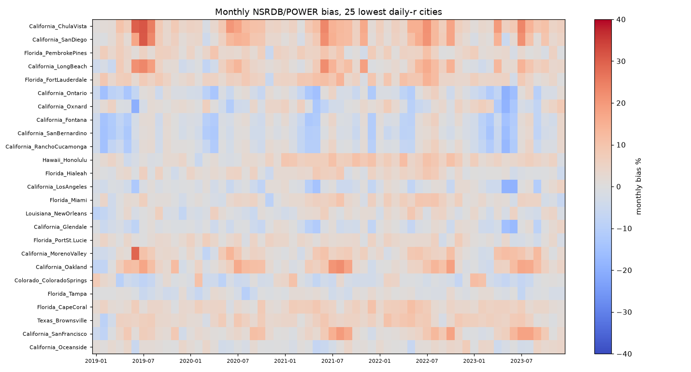

# Agent: solar-irradiance coherence, HEDW-US (NSRDB) vs NASA POWER, 2019–2023

## Question

Is the HEDW-US solar irradiance coherent with NASA POWER (ASDC) over the paper's period (2019-01-01 to 2023-12-31 UTC)? Where it is not, what is anomalous, and is the anomaly in HEDW-US's data or in the comparison?

HEDW-US's `solar_GHI` is the NSRDB GOES aggregated v4.0.0 GHI requested by the authors' code; see [source-upstream-code.md](source-upstream-code.md). `data.zip` is still not available ([concept-data-access.md](concept-data-access.md)). The agent therefore re-downloads that NSRDB stream with the authors' exact request and compares it with POWER `ALLSKY_SFC_SW_DWN`. Values and timing equal HEDW-US's up to its row labels, as the [concept-nsrdb.md](concept-nsrdb.md) half-hour note explains. Processing that HEDW-US did after the download (the 40 quarantined cities, smoothing) is not checked here.

## Design

| Step | What | Code |
|---|---|---|
| Data | 150 target cities: 745 NSRDB city-years (Anchorage has no GOES coverage) and 150 POWER 5-year hourly series | `agent/fetch/fetch_all.py` |
| Detector | Per city: correlation, lag scan, bias, RMSE, physics checks, monthly bias, anomalous days (robust z of the daily log ratio) | `agent/coherence.py` |
| Aggregation | Robust z across cities, flags, `cities.csv`, `city_years.csv`, `anomalous_days.csv`, `summary.json`, figures | `agent/aggregate.py` |
| Gap-fill audit | NSRDB `fill_flag` / `cloud_type` vs the anomalies | `agent/fillflags.py` |
| Aurora | `qsub` to `debug`, project `IOWarp`: 1 node, `mpiexec` N ranks over the city manifest, then aggregation | `agent/pbs/{submit.sh,coherence.pbs,worker.sh}` |
| Login node | The same worker run as P local processes | `agent/run_local.sh` |
| clio-agent | Plugin agent `hedw/solar-coherence` (clio-agent 0.9.7.1, Mistral Large 4 on ALCF Minerva) with tools `hedw_report` (run digest or one city) and `hedw_day` (hourly NSRDB vs POWER for one city-day) | `agent/clio-agent/` |
| clio-coder | Headless `clio-coder run` (target `alcf-metis`, `gpt-oss-120b`) writes `interpretation.md`; `check_numbers.py` checks every number in it against the run files | `agent/interpret.sh`, `agent/check_numbers.py` |

Metric definitions and thresholds are in [concept-solar-coherence.md](concept-solar-coherence.md).

## Runs

| Run | Where | Job | Detect | Aggregate |
|---|---|---|---|---|
| `agent/results/run_20261120T143434Z_local_p16/` (reference) | Login node `aurora-uan-0012`, 16 processes | none | 2.59 s | 1.34 s |
| `agent/results/run_20261120T143515Z_n1p50/` | Compute node `x4315c1s0b0n0`, 50 ranks | PBS 9107657 | 7.18 s | 2.90 s |
| `agent/results/run_20261120T143947Z_n1p16/` | Compute node, 16 ranks | PBS 9107666 | 7.43 s | 2.95 s |

The three runs give the same `summary.json`, except the timing fields, and a byte-identical `cities.csv`. Workflow timings are in [workflow_aurora_clio.md](workflow_aurora_clio.md).

## Results

### Timing and agreement (149 cities)

- **Phase:** the best lag is **0 h in all 745 city-years**. NSRDB's H:30 value lines up with POWER's H:00–H+1:00 mean, as predicted. HEDW-US row labels are therefore 30 min early but internally consistent (see [concept-nsrdb.md](concept-nsrdb.md)). There is no time-zone or DST error in the solar stream.
- **Correlation:**

  | Correlation | Median | p05 | Min |
  |---|---|---|---|
  | Hourly r | 0.9785 | 0.967 | 0.9604 |
  | Daily r | 0.9768 | 0.9321 | 0.8987 (Chula Vista) |

- **Error:**
  - **Bias** (ΣNSRDB/ΣPOWER − 1): median +1.11 %, p05 −2.09 %, p95 +4.76 %, range −4.17 % to +10.47 %.
  - **Daylight RMSE:** median 79.5 W/m².
  - Bias correlates with latitude at −0.216.
- **Physics:**
  - No night-time GHI, no negative GHI, and no missing hours in either source.
  - 26 cities have short flat runs of 3 to 6 daylight hours, too few to matter.
- **Per-city-year thresholds:** none of the city-years trips one, so the dataset passes the [concept-solar-coherence.md](concept-solar-coherence.md) thresholds everywhere.

### Anomalous cities: 17, all coastal or at a mountain edge

The cross-city robust z (|z| > 3) flags 17 cities. Every one of them sits where a 1° (~100 km) POWER cell mixes ocean and land, or mountains and basin:

| Group | Cities | Daily r | Bias |
|---|---|---|---|
| Coastal Southern California | Chula Vista, San Diego, Long Beach, Los Angeles, Oxnard, Glendale | 0.8987–0.9505 | −3.09 to +10.47 % |
| Inland Empire | Ontario, Fontana, San Bernardino, Rancho Cucamonga, Moreno Valley | 0.9184–0.9508 | −4.17 to +5.10 % |
| Bay Area | Oakland (bias only, z = +3.3) | 0.9549 | +7.25 % |
| South Florida | Fort Lauderdale, Pembroke Pines, Hialeah, Miami | 0.9133–0.9420 | +2.19 to +5.76 % |
| Hawaii | Honolulu | 0.935 | +4.05 % |

Pembroke Pines and Rancho Cucamonga are among the 7 targets that cannot be in the release.

Mean monthly bias by calendar month (`seasonal_bias.txt` in the run):

| Group | Jan | Feb | Mar | Apr | May | Jun | Jul | Aug | Sep | Oct | Nov | Dec | Mean daily r |
|---|---|---|---|---|---|---|---|---|---|---|---|---|---|
| SoCal coast (6) | 1.2 | 0.8 | 0.2 | 1.4 | −1.1 | 3.5 | **9.1** | **6.7** | 2.7 | 3.0 | 4.4 | 1.8 | 0.923 |
| Inland Empire (5) | −1.1 | **−5.1** | **−7.0** | **−6.6** | **−6.6** | −0.1 | 3.3 | 3.0 | −1.1 | −0.7 | 0.9 | −1.6 | 0.933 |
| South Florida (4) | 2.6 | 3.6 | 2.4 | 4.5 | 4.3 | 3.6 | 6.4 | 5.5 | 3.1 | 1.9 | −0.4 | 1.8 | 0.928 |
| Honolulu | 4.3 | 3.0 | 3.7 | 5.5 | 1.7 | 2.6 | 5.2 | 4.6 | 3.7 | 5.7 | 5.7 | 3.4 | 0.935 |
| All other 133 | −1.6 | 0.1 | −0.7 | 0.5 | 1.6 | 2.2 | 2.7 | 2.3 | 2.5 | 0.6 | −0.6 | −1.8 | 0.977 |

**Interpretation (hypotheses, not verified against ground stations):**
- **Coastal Southern California:** NSRDB reads high against POWER in summer. That fits a POWER cell that takes in the persistent offshore marine stratus, while NSRDB's ~4 km pixel sees the city after the morning burn-off.
- **Inland Empire:** NSRDB reads low in late winter and spring. Here the POWER cell spans the San Gabriel and San Bernardino mountains and the high desert.
- **South Florida and Honolulu:** POWER cells that are partly ocean.

These are representativeness differences between a 4 km and a 100 km product. They are not errors in HEDW-US.

### Anomalous days and a real NSRDB artefact: 2020-02-14

- **Volume:** each city's own robust outlier test flags a median of 38 days per city, up to 227 (San Bernardino and Ontario), 7,528 city-days in all. Most are cloud-scale disagreements.
- **Spread across cities:** counting cities where NSRDB is under half of POWER's daily total (with POWER above 2,000 Wh/m²) per date (`widespread_dates.json`):
  - **2020-02-14 stands out, with 31 cities.** They span 17 eastern states, from Alabama and Georgia to Minnesota and Massachusetts.
  - The next date, 2020-03-13, has 12 cities.
- **Birmingham hour by hour:**
  - On 2020-02-14, POWER all-sky equals POWER clear-sky in 9 of 10 daylight hours: a clear day.
  - NSRDB has DNI = 0 and a flat GHI of 25–51 W/m² from sunrise to sunset.
  - On 2020-02-15, NSRDB follows clear-sky closely: 764 W/m² at 17 UTC against POWER clear-sky 775.
- **Cause:** NSRDB's own flags (`raw/nsrdb/flags/Alabama_Birmingham_2020_flags.csv`) give every daylight hour that day **Fill Flag 100** and Cloud Type 4 (super-cooled water). The irradiance was gap-filled rather than retrieved.
- **Effect on HEDW-US:** the regional filled day passes into HEDW-US's `solar_GHI` unflagged. The dataset keeps no fill flag, so pristine cities with "zero missing values" can still carry imputed solar values. The agent flags these days for removal or masking in solar-driven load models.
- **NSRDB reads high:** this mostly happens in snow events, for example 2021-02-17 (Winter Storm Uri) in 15 cities and 2021-02-10 in 11. This fits the known difficulty of telling snow from cloud in satellite retrievals. For Dallas on 2021-02-17, NSRDB has 2,623 Wh/m² against POWER's 719.

### Gap filling across all cities

*Pending: the `fill_flag` download for all 745 city-years is running; results are filed in `fillflags.json`.*

## LLM steps and their reliability

### clio-agent (`hedw/solar-coherence`)

- **Benchmark:** `agent/results/llm/bench_20261120/` asks 5 questions whose expected answers are taken from the run files, 2 repetitions each:
  - 10/10 correct;
  - 1 tool call per question;
  - median 2.2 s, max 3.5 s;
  - median 16,066 input tokens.
- **Open question (Dallas, 2021-02-17):** `agent/results/llm/q_dallas_20210217.json` took 20.6 s and 5 tool calls (1 `hedw_report` and 4 `hedw_day`; the agent fetched the neighbouring days itself). Every number it quoted was checked against the raw files: 4,923/3,645, 3,920/2,608, 2,623/719 and 3,806/2,166 Wh/m². Its explanation, resolution plus snow, is a reasonable hypothesis but was presented with more confidence than the data supports.
- **Operations:** running clio-core's ctest on the same login node killed the agent's embedded runtime, because `cr_pre_test_cleanup` and `cr_post_test_cleanup` `kill -9` port 9413 and every `clio_run`. The server answered 503 with `ClioCoreRuntimeLostError` until it was restarted. See [workflow_aurora_clio.md](workflow_aurora_clio.md).

### clio-coder interpretation (`interpretation.md`, 16 s)

`check_numbers.py` found **71 of 71 numbers supported** by the run files. The prose nevertheless has 4 errors, recorded in a reviewer note at the top of the file:
1. It says `correlation_bias_vs_lat` is not in the files. It is in `summary.json` (−0.216).
2. It calls the flagged cities "higher latitude". They are among the most southerly.
3. It lists only the first 10 flagged cities and misses South Florida and Honolulu, because the prompt limited it to 40 CSV lines.
4. It gets the physics backwards: snow "low GHI", and fog yielding positive bias because POWER's "clear-sky model remains high".

It did surface the Birmingham 2020-02-14 day. Takeaway: number checking catches fabricated numbers, not wrong reasoning. Use the clio-agent tools (`hedw_report`, `hedw_day`) for facts, and treat clio-coder prose as a draft.

## Limitations

- This compares NSRDB with POWER, not the released HEDW-US files. The 141-city membership is inferred: 7 targets lack a county mapping, Anchorage has no data, and one more is unknown. Processing that HEDW-US applied after the download is not covered.
- POWER is not ground truth. Its 1° cells explain most of the flagged cities. A ground-station check (SURFRAD, SOLRAD) would settle which product is right.
- The anomalous-day test is per city and relative, so the threshold (|z| > 4 and > 1 kWh/m²/day) sets the count.
- Reading the hourly Fill Flag as a percentage is an inference from its values, not from documentation.
